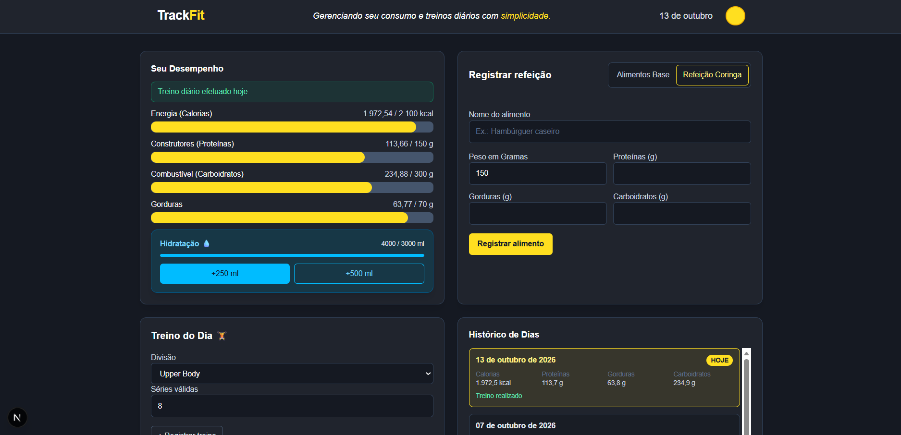

# TrackFit

Dashboard para acompanhar a alimentação, a hidratação e os treinos do dia.



## Funcionalidades

- Acompanhamento diário de calorias, proteínas, carboidratos e gorduras em relação às metas.
- Registro de refeições a partir de alimentos cadastrados ou com a opção de cadastrar uma refeição personalizada.
- Registro da hidratação em incrementos de 250 ml ou 500 ml.
- Registro do treino do dia por divisão e número de séries válidas.
- Histórico diário de consumo nutricional e treinos.

## Tecnologias

**Frontend**
- Next.js 16 e React 19
- TypeScript 5
- Tailwind CSS 4

**Backend**
- Java 21 e Spring Boot 4
- Spring Web, Spring Data JPA, Spring Security e Bean Validation
- MySQL e Flyway para persistência e migrações do banco
- Maven Wrapper para execução e build

## Pré-requisitos

- Node.js e npm
- JDK 21
- MySQL

## Como executar

### 1. Configure o banco e o backend

Crie um banco de dados MySQL e configure a URL, o usuário e a senha em `server/src/main/resources/application.properties`. Esse arquivo é local e ignorado pelo Git; não compartilhe nem versione credenciais reais. As migrações do Flyway são executadas pelo backend.

No terminal, a partir da raiz do projeto:

```powershell
cd server
.\mvnw.cmd spring-boot:run
```

Em sistemas Unix, use `./mvnw spring-boot:run`.

### 2. Execute o frontend

Em outro terminal, a partir da raiz do projeto:

```powershell
cd client
npm install
npm run dev
```

Abra [http://localhost:3000](http://localhost:3000). O frontend se comunica com a API em `http://localhost:8080`.

## API principal

| Método | Rota | Descrição |
| --- | --- | --- |
| `GET` | `/daily/today` | Resumo do dia atual |
| `GET` | `/daily` | Histórico diário |
| `PATCH` | `/daily/water-250` | Adiciona 250 ml de água |
| `PATCH` | `/daily/water-500` | Adiciona 500 ml de água |
| `GET` | `/alimentos` | Lista os alimentos disponíveis |
| `GET` / `POST` | `/food` | Lista e registra refeições |
| `POST` | `/food/coringa` | Cadastra e registra uma refeição personalizada |
| `GET` / `POST` | `/workout` | Lista e registra treinos |
